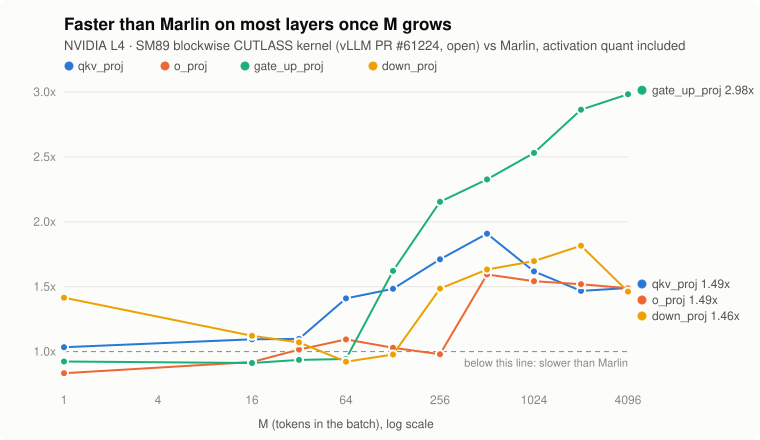

# Block-FP8 and INT8 GEMMs on Ada GPUs: before and after

Ada GPUs (SM89: L4, L40S, RTX 4090, RTX 6000 Ada) have FP8 tensor cores, but in vLLM today a block-FP8 checkpoint (Qwen3-\*-FP8, DeepSeek-style 128x128 blocks) doesn't use them on Ada. It falls back to Marlin, a weight-only kernel. This repo holds the measurements behind my work on that gap and on a related INT8 slowdown: every number, the GPU it ran on, the vLLM commit, the command and the raw output.

All of this is **work in progress**. None of the vLLM pull requests below is merged yet.

| What | vLLM PR / issue | Status (Nov 3, 2026) |
|---|---|---|
| Blockwise FP8 CUTLASS kernel for SM89 | [#61224](https://github.com/vllm-project/vllm/pull/61224) (for issue [#58241](https://github.com/vllm-project/vllm/issues/58241)) | open, waiting for review |
| Run the block-FP8 tests on SM89 | [#60171](https://github.com/vllm-project/vllm/pull/60171) | open |
| INT8 small-batch tiles picked by wave count | [#62128](https://github.com/vllm-project/vllm/pull/62128) (issue [#56924](https://github.com/vllm-project/vllm/issues/56924)) | open, ready for review |
| Fix `benchmark_block_fp8_gemm.py` | [#59261](https://github.com/vllm-project/vllm/pull/59261) | open |
| Fused-MoE block-FP8 configs for L40S | not opened | paused (gain too small, see below) |

## 1. The gap

On an L4, vLLM picks `MarlinFP8ScaledMMLinearKernel` for block-FP8 weights: the weights are dequantized and the matmul runs in BF16, so the FP8 tensor cores sit idle. At small batches Marlin is hard to beat (it reads half the bytes of BF16 and there's no activation to quantize). At prefill sizes it's the slowest option on the table: on `gate_up_proj` at M = 4096 Marlin takes 26.6 ms, BF16 14.1 ms and vLLM's own Triton block-FP8 kernel 10.5 ms.

## 2. The kernel (PR #61224)

A CUTLASS GEMM for SM89 that takes vLLM's block layout directly: one activation scale per token per 128 columns (1x128) and one weight scale per 128x128 block. It runs on Ada's FP8 tensor cores (QMMA e4m3). Two things made it fast enough to be worth shipping:

- **Scale once per K block.** The first version applied scales after every MMA step and needed 255 registers with 600 bytes of spills; it was about 4x slower than Triton. Accumulating one 128-wide K block unscaled and scaling once made it spill-free.
- **A tile per batch size.** 16x128 (M ≤ 16), 32x64 (M ≤ 32), 64x128 (M ≤ 64), 128x128 with threadblock swizzle 4 above that, picked from a 16-config sweep on the L4.

GEMM time on an L4, Qwen3-8B shapes, µs (median). Triton and the new kernel include activation quantization; Marlin needs none:

| layer (N x K) | M | Marlin | Triton block-FP8 | **new kernel** | vs Marlin |
|---|---|---|---|---|---|
| qkv_proj (6144 x 4096) | 1 | 20.6 | 77.2 | **20.0** | 1.03x |
| | 64 | 53.1 | 57.1 | **37.6** | 1.41x |
| | 4096 | 3496.3 | 2746.4 | **2347.2** | 1.49x |
| o_proj (4096 x 4096) | 1 | 16.0 | 65.1 | **19.2** | 0.83x |
| | 64 | 38.2 | 49.5 | **35.0** | 1.09x |
| | 4096 | 2415.0 | 1832.3 | **1624.0** | 1.49x |
| gate_up_proj (24576 x 4096) | 1 | 399.1 | 449.9 | **432.1** | 0.92x |
| | 64 | 440.5 | 468.9 | **467.2** | 0.94x |
| | 4096 | 26559.4 | 10513.4 | **8902.4** | 2.98x |
| down_proj (4096 x 12288) | 1 | 62.3 | 162.9 | **44.0** | 1.42x |
| | 64 | 174.7 | 222.8 | **189.5** | 0.92x |
| | 4096 | 9003.1 | 5583.8 | **6159.0** | 1.46x |

Every M from 1 to 4096 and the BF16 / per-tensor columns: [`gemm_bench.csv`](results/blockwise-fp8-l4-2026-10-10/gemm_bench.csv).

End to end on the same L4, `Qwen/Qwen3-8B-FP8`, `--max-model-len 4096`:

| | main (Marlin) | PR #61224 | change |
|---|---|---|---|
| `vllm bench throughput`, 1024 in / 128 out, 300 prompts | 1929 tok/s | 2739 tok/s | 1.42x |
| `vllm bench latency`, batch 32 | 20.16 s | 15.11 s | 1.33x faster |
| `vllm bench latency`, batch 1 | 4.77 s | 4.94 s | 3.6% slower |
| gsm8k 5-shot, 250 samples (flexible / strict) | 0.892 / 0.892 | 0.904 / 0.896 | same within noise (±0.02) |

Correctness: relative error vs a dequantize-then-matmul reference is 1.6e-3 to 1.7e-3 at every checked M, the same as the Triton kernel. `tests/kernels/quantization/test_block_fp8.py`: 226 passed, 255 skipped, 0 failed (the 5 CUTLASS block-FP8 tests that skip on SM89 today run and pass).

**Known gaps.** Batch-1 decode is 3.6% slower end to end. That comes from `o_proj` and `gate_up_proj` at M = 1 (0.83x and 0.92x of Marlin above), and `gate_up_proj` is the biggest layer. `down_proj` at M = 4096 is about 10% behind Triton. Both are follow-up tuning.

**Independent check.** A contributor ([BESzbing](https://github.com/vllm-project/vllm/pull/61224#issuecomment-6573142238)) built the PR on vLLM master `0e5b2ba118` on an RTX 4090 (Nov 2) and posted: it applies cleanly, the selector switches to the CUTLASS kernel, error matches Triton's to bf16 rounding, and it's 1.03x to 3.74x faster than the Triton block-FP8 kernel (2.05x to 3.74x at M ≤ 32). Those are their numbers on their machine; they aren't in `results/`.

## 3. INT8 small-batch tiles (PR #62128)

Issue #56924: on SM89, INT8 W8A8 GEMMs get about 1.5x slower when M goes from 16 to 17, and again at 32 to 33, because the dispatch switches to taller tiles and small layers end up with very few thread blocks. On my RTX 4090, `q_proj` went from 4.92 µs at M = 16 to 7.81 µs at M = 17.

The first fix kept the 16-row tiles past M = 16 for small layers. On the 4090 (128 SMs) that cut total GEMM time over M = 17–64 by 13% (409.5 → 355.3 µs, six Qwen3-1.7B shapes). A reviewer then ran it on an RTX 4500 Ada (60 SMs) and `down_proj` got 35–81% slower: the smaller tiles added a second wave of thread blocks on a GPU with fewer SMs. The fix was to pick tiles by counting waves instead of by layer size.

Total CUTLASS time over M = 17–64, six shapes:

| GPU (SMs) | stock | first version | wave rule (in the PR) | source |
|---|---|---|---|---|
| RTX 4090 (128) | 409.5 µs | 355.3 µs | same tiles as the first version | [results](results/int8-small-m-rtx4090-2026-10-16) |
| L4 (58) | 836.0 µs | 857.8 µs (2.6% slower) | **801.4 µs (4.1% less)** | [results](results/int8-small-m-l4-2026-10-22) |
| RTX 4500 Ada (60) | 626.2 µs | slower on 2 layers | **602.4 µs (3.8% less)** | reviewer's run, [on the PR](https://github.com/vllm-project/vllm/pull/62128) |

On the L4 every cell the wave rule changes got faster (0.59–0.82x of stock); every other cell runs the stock kernel. INT8 tests with the exact committed file: 400 passed, 54 skipped. Same-kernel cells moved by 0.96x–1.06x between runs on the L4, so read single cells with that noise in mind; the totals agreed across two separate builds (804.6 and 801.4 µs). The story is written up in [My GPU fix was 13% faster on one card and 81% slower on another](https://amankarki.hashnode.dev/gpu-fix-faster-on-one-card-slower-on-another-waves).

## 4. Fused-MoE configs for L40S (tried, paused)

vLLM ships no block-FP8 fused-MoE tuning files for L40S, RTX 4090, RTX 6000 Ada or L4 (only L20 / L20Y), so these run on default configs. A small test on an L40S (vLLM `5f63ea461`), E=128, N=768 (Qwen3-30B-A3B, TP1), with a file tuned only at M = 16:

| M | default µs | tuned µs | change |
|---|---|---|---|
| 1 | 30.88 | 34.69 | 12% slower (M=16 config used at M=1) |
| 16 | 594.42 | 574.45 | 3.4% faster |
| 64 | 912.98 | 877.96 | 3.8% faster |

Tuning took 30–60 minutes per batch size (1,920 configs each), so a full file is roughly 10–18 hours per shape. For 3–4% at decode sizes that wasn't worth it; the PR is paused. One run each, so treat the percentages as rough. Raw: [results](results/moe-configs-l40s-2026-10-24).

## 5. The benchmark script (PR #59261)

vLLM's `benchmarks/kernels/benchmark_block_fp8_gemm.py` had stopped running on main (API drift), and its "cutlass" line silently ran whatever kernel the selector picked. The fix makes each provider run the kernel it names. A reviewer asked for an H100 run; the output for all 11 DeepSeek-V3 shapes on an H100 PCIe is in [results](results/block-fp8-bench-h100-2026-10-17) (not Ada, but it's the tool the Ada numbers can be checked with).

## Reproduce

| Run | GPU | vLLM | Command |
|---|---|---|---|
| GEMM table | L4 | PR #61224 branch on base `1664c4f44`, torch 2.13.0+cu129, CUDA 12.9 | `python scripts/bench_sm89_block_fp8.py` |
| End to end | L4 | precompiled main `1664c4f44` vs the PR branch | `MAIN_VENV=… PR_VENV=… bash scripts/e2e_l4.sh` |
| INT8 small M | RTX 4090, L4 | `0.32.0rc1.dev293+g1a5b18706` (stock vs patched build) | `python scripts/repro_int8_small_m.py` |
| MoE configs | L40S | main `5f63ea461` | vLLM's `benchmarks/kernels/benchmark_moe.py` with `--model Qwen/Qwen3-30B-A3B-FP8 --dtype fp8_w8a8 --batch-size 1 4 16 64` (full arguments on line 4 of `bench_default.txt`) |
| H100 script check | H100 PCIe | PR #59261 branch `bd4774db9` | `python benchmarks/kernels/benchmark_block_fp8_gemm.py` |

The kernel benchmark needs a vLLM build with `cutlass_scaled_mm_supports_block_fp8` true on SM89 (the PR branch, built with `TORCH_CUDA_ARCH_LIST=8.9`); on stock vLLM the new-kernel column is skipped. `python charts/make_charts.py` redraws the chart from the CSV.

Each folder in `results/` is one run: the raw output as printed, with pod-specific warnings left in.

## Notes

- Every number in this repo was measured by me on the GPU named, except where it's credited to someone else (the RTX 4500 Ada totals and the RTX 4090 check of #61224). Rented GPUs, single runs unless stated; prices and clocks weren't controlled.
- I used an AI assistant to help analyze the sweeps, draft parts of the kernel and dispatch code, and write this report. I ran every build, test and benchmark here myself.

Code and data: MIT ([LICENSE](LICENSE)). The two scripts in `scripts/` that call vLLM need a vLLM install (Apache-2.0).

Aman Karki · [GitHub](https://github.com/amankarki151) · [articles](https://amankarki.hashnode.dev)
